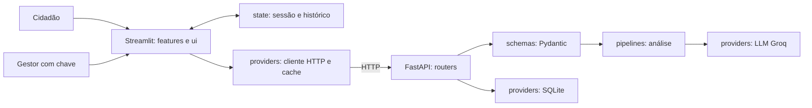

# ZelaBairro — Global Solution 2026/2

Front-end em Sistemas de IA · CitizenTech · FIAP

| Integrante | RM |
|---|---|
| Luiz Henrique Poss | 562177 |
| Luis Filipe Chaves Amorim | 564706 |
| Felipe Stefani Honorato | 563380 |

## Problema, público e fundamentação

Moradores precisam descrever e acompanhar problemas de zeladoria, como buracos, iluminação e calçadas danificadas. A POC organiza esses relatos, oferece uma sugestão revisável de categoria/prioridade e permite acompanhar atualizações da gestão. O público principal são moradores de bairros urbanos; idosos, pessoas com deficiência e outros pedestres podem ser especialmente afetados por barreiras de circulação. Gestores municipais são usuários secundários da visão de acompanhamento.

Como contexto nacional, o Censo 2022 identificou que **68,8% dos moradores das áreas com características urbanas pesquisadas viviam em vias sem rampa para cadeirantes**. A fonte é o [IBGE — Características Urbanísticas do Entorno dos Domicílios](https://educa.ibge.gov.br/jovens/materias-especiais/22746-censo-2022-revela-que-88-5-dos-moradores-moravam-em-vias-pavimentadas.html). O dado fundamenta a relevância da acessibilidade urbana; não é diagnóstico do bairro do usuário nem resultado obtido pelo ZelaBairro.

**ODS 11 — Cidades e comunidades sustentáveis:** a proposta apoia participação na gestão urbana (meta 11.3) e o registro de barreiras ao uso de espaços públicos (meta 11.7). A relação é uma contribuição pretendida, não impacto social já medido. Referência: [ONU Brasil — ODS 11](https://brasil.un.org/pt-br/sdgs/11).

## Fluxo CitizenTech

1. O cidadão informa bairro e descrição, sem endereço residencial ou dados pessoais.
2. A interface valida campos obrigatórios e tamanhos e envia o pedido por HTTP.
3. O FastAPI normaliza e valida com Pydantic; o provedor chama o LLM no back-end.
4. O JSON retornado é validado antes de apresentar resumo, categoria, prioridade e justificativa.
5. O cidadão confirma ou corrige categoria, prioridade e resumo e marca uma confirmação específica daquela análise.
6. A API registra o relato no SQLite e gera o protocolo. A gestão pode atualizar o andamento.

A confirmação é reiniciada em cada análise. Uma nova análise com falha não permite enviar a sugestão antiga. O protocolo representa registro nesta POC; não comprova abertura de chamado oficial na prefeitura.

## Arquitetura e decisões técnicas



| Camada | Responsabilidade e escolha |
|---|---|
| `frontend/features/` | Telas de registro, histórico e gestão, separadas por jornada. Streamlit permite construir formulários e gráficos em Python com pouco código. |
| `frontend/ui/` | Cartão e apresentação de prioridade/status reutilizados. Texto e ícones acompanham a criticidade. |
| `frontend/state/` | Identificador da sessão, análise pendente, último protocolo e histórico. `session_state` preserva dados nos reruns. |
| `frontend/providers/` | Único cliente da API. `cache_resource` reutiliza a conexão; `cache_data` guarda consultas por 30 segundos, separadas por cidadão e chave de gestão. Criação/atualização invalida as consultas afetadas. |
| `backend/routers/` e `schemas/` | Endpoints HTTP e contrato Pydantic de entrada/saída. Espaços externos são retirados antes da validação de tamanho. |
| `backend/pipelines/` e `providers/` | Lógica de análise separada do acesso ao LLM e SQLite. O front-end nunca recebe a chave da IA. |
| SQLite | Persistência simples para uma POC de uma única instância; o volume Docker mantém os registros após reiniciar os serviços. |
| Docker Compose | Dois serviços com rede interna e volume, tornando a execução reproduzível fora da máquina do grupo. A interface aguarda a API saudável. |

O prompt limita categorias e prioridades, proíbe inventar localização/risco e trata o relato como dado. O formato JSON permite preencher componentes de interface; Pydantic restringe enums e comprimentos antes de devolver a resposta. Solicitar JSON não garante correção factual: a revisão humana continua necessária.

## Configurar a Groq

1. Copie `.env.example` para `.env`, se ainda não existir.
2. Preencha `LLM_API_KEY` com sua chave Groq e defina uma chave longa e aleatória em `MANAGER_API_KEY`.
3. Mantenha `DEMO_MODE=false` para usar o LLM real.

```dotenv
LLM_BASE_URL=https://api.groq.com/openai/v1
LLM_API_KEY=
LLM_MODEL=openai/gpt-oss-20b
DEMO_MODE=false
```

O modelo deve estar disponível na conta. Consulte [compatibilidade da API Groq](https://console.groq.com/docs/openai), [modelos](https://console.groq.com/docs/models) e [JSON/saídas estruturadas](https://console.groq.com/docs/structured-outputs). O cliente usa JSON Object Mode e valida o resultado localmente com Pydantic. Não é uma alegação de conformidade forçada por JSON Schema no provedor.

Sem configuração do LLM, a análise retorna 503; falhas ou saída inválida do provedor retornam 502. **Não há fallback silencioso.** Para explorar as telas sem consumir IA, use explicitamente `DEMO_MODE=true`: a interface identifica regras demonstrativas, que não comprovam a integração exigida.

Nunca publique `.env`, chaves, bancos com dados de pessoas ou gravações contendo credenciais. `.gitignore` e `.dockerignore` excluem esses arquivos. O front-end Docker recebe apenas `API_BASE_URL`, nunca a chave do LLM.

## Executar com Docker — opção B do enunciado

Requisito: Docker com Compose disponível.

```bash
docker compose up --build
```

- Interface: http://localhost:8501
- API: http://localhost:8000/health
- Contrato da API: http://localhost:8000/docs

O primeiro build pode demorar. O Compose espera a API responder ao healthcheck. O banco usa o volume `zelabairro_data`. Para interromper sem apagar os dados, execute `docker compose down`; não acrescente `-v` se quiser preservar os registros.

**Execução comprovada fora da máquina do grupo:** [GitHub Actions — execução aprovada](https://github.com/luizhenriqueposs7/FRONT_GS_26.2/actions/runs/43371755289). Os jobs `testes` e `docker` passaram no commit `4764f74`, incluindo os 42 testes. O Docker construiu e iniciou os dois serviços, aguardou os healthchecks da API e da interface e verificou os endpoints. O smoke test usa dados sintéticos e regras explícitas; os testes reais do LLM estão registrados separadamente abaixo. O vídeo final exibe a evidência do CI e o fluxo local com IA real.

`CORS_ORIGINS` deve conter a URL exata da interface, separando múltiplas origens por vírgula. O padrão local é `http://localhost:8501`; não use `*` em produção. Em hospedagem, configure HTTPS, segredos no ambiente e o endereço público da API.

## Executar localmente no Windows

Na raiz do projeto:

```powershell
python -m venv .venv
.\.venv\Scripts\python.exe -m pip install -r requirements-backend.txt -r requirements-frontend.txt
.\.venv\Scripts\python.exe -m uvicorn backend.main:app --env-file .env --host 127.0.0.1 --port 8000
```

Em outro terminal, na mesma pasta:

```powershell
$env:PYTHONPATH = (Get-Location).Path
$env:API_BASE_URL = 'http://localhost:8000'
.\.venv\Scripts\python.exe -m streamlit run frontend/app.py --server.address=127.0.0.1
```

Em Linux/macOS, use `.venv/bin/python`; para a interface, execute `PYTHONPATH=. .venv/bin/python -m streamlit run frontend/app.py`. O Uvicorn carrega o `.env` pelo argumento `--env-file`; não copie chaves para comandos ou para a interface pública.

## Uso, estado e acessibilidade

- O formulário agrupa edições e só chama a análise no envio. O LLM não é chamado ao mudar um filtro ou marcar a confirmação.
- O histórico é mantido na sessão e usado na lista; o painel guarda os relatos na sessão e os utiliza no gráfico Plotly. Atualizar solicitações/painel busca mudanças da API; filtros operam sobre dados já carregados.
- O identificador temporário é um UUID da sessão. Atualizar a página/reiniciar o navegador pode perder a associação ao histórico; não há conta persistente nesta POC.
- Rótulos visíveis, linguagem direta, mensagens de erro, spinner durante operações, estados vazios e alto contraste.
- Categoria, prioridade e status têm texto; prioridade também usa cor e ícone. A informação não depende somente da cor.
- O gráfico Plotly oferece hover e zoom e dois filtros por categoria/status. O cartão e a apresentação de prioridade são componentes reutilizados.
- Conferir a navegação com Tab/Shift+Tab e a compreensão do formulário nos testes com pessoas. Leitor de tela e conformidade WCAG formal não foram certificados.

## Ética, segurança e limites

O LLM pode errar, alucinar ou reproduzir vieses de linguagem/região. Um relato ambíguo pode receber categoria ou prioridade inadequada; o usuário deve revisar e corrigir antes de confirmar. Validação estrutural não verifica a verdade do relato. A classificação não é decisão oficial, não verifica a ocorrência e não promete atendimento ou redução de prazo.

Relatos maliciosos podem tentar manipular a IA; o prompt separa dados de instruções, restringe o formato e mantém revisão humana. Esses cuidados reduzem risco, sem eliminar ataques. A POC não aciona emergência, não detecta crimes, não identifica pessoas e não substitui os canais oficiais.

Use somente dados sintéticos na demonstração. Em uso real, não envie nomes, telefones, documentos ou endereço residencial ao LLM. A chave compartilhada de gestão é uma proteção de demonstração, não RBAC individual. CORS não substitui autenticação. O identificador da sessão funciona como referência privada para consultar relatos; não deve ser compartilhado. Antes de produção são necessários autenticação, autorização individual, retenção/exclusão de dados, monitoramento e revisão de privacidade.

## Testes automatizados e validação da IA

```bash
python -m pytest -v --junitxml=docs/evidencias/testes.xml
```

No Windows com o ambiente virtual, substitua `python` por `.\.venv\Scripts\python.exe`. Os testes usam banco temporário, credenciais sintéticas e respostas simuladas nas verificações de contrato do LLM; não gastam a chave real. Cobrem API, classificação demonstrativa, validação, falhas do provedor, erros do cliente, cache e o ciclo de confirmação/histórico com Streamlit AppTest.

**Verificação de 13/11/2026:** 42 testes aprovados, com [relatório JUnit](docs/evidencias/testes.xml). As regressões verificam listas da API fora do contrato, limpeza de mensagens antigas antes do rerun, edição/persistência do resumo, rejeição de resumo vazio ou curto e acesso ao acompanhamento pelo botão do protocolo.

Para gerar **evidência real** com três casos, inicie a API com `.env` e `DEMO_MODE=false`, e execute:

```bash
python scripts/validar_ia.py
```

O script exige modo LLM, verifica `fonte_analise=llm`, preserva as respostas em JSON e atualiza a tabela abaixo com o modelo e a data. Os casos/expectativas são definidos antes de chamar o modelo; divergências são registradas e fazem o comando falhar. Os arquivos não contêm a chave.

Na primeira execução, a justificativa do buraco acrescentou “alto tráfego”, informação ausente da entrada. O prompt foi ajustado para proibir detalhes inventados, restringir a justificativa e exigir evidência explícita para prioridade Alta. O reteste manteve as três categorias esperadas e retirou a afirmação sobre tráfego. [Comparação e aprendizado do ajuste](docs/evidencias/ajuste-prompt.md). Isso é validação da IA; não é feedback de participantes humanos.

<!-- IA:INICIO -->
Execução real em 2026-11-11T02:36:43.086464+00:00, modelo `openai/gpt-oss-20b`.

| Entrada | Esperado antes do teste | Saída obtida | Ajuste realizado |
|---|---|---|---|
| Há um buraco grande no asfalto perto da praça. | Categoria Buraco | Buraco; prioridade Média | Nenhum ajuste após este caso: categoria correspondeu ao esperado. |
| Poste apagado e fio exposto na calçada. | Categoria Iluminação | Iluminação; prioridade Alta | Nenhum ajuste após este caso: categoria correspondeu ao esperado. |
| A calçada está quebrada e dificulta a passagem. | Categoria Calçada | Calçada; prioridade Média | Nenhum ajuste após este caso: categoria correspondeu ao esperado. |

[Respostas completas desta execução](docs/evidencias/ia-20261111T023643086464Z.json).

Estes casos sintéticos não estimam acurácia geral nem substituem validação com pessoas.
<!-- IA:FIM -->

## Validação com pessoas

**Situação: registros de três participantes recebidos do grupo e ajustes implementados.** As sessões foram realizadas em sequência, antes das últimas correções. A data e o identificador da versão testada não foram informados. Os participantes são identificados como P1, P2 e P3 na documentação pública.

As [observações e a comparação antes/depois](docs/evidencias/usabilidade-20261113.md) preservam o feedback fornecido e distinguem a sessão com pessoas da verificação técnica posterior. O [roteiro e a ficha](docs/validacao.md) ficam disponíveis para uma próxima coleta.

| Participante | Perfil geral | Observação relatada | Ajuste implementado e verificação |
|---|---|---|---|
| P1 | Estudante universitária, familiarizada com aplicativos | Dúvida sobre poder editar as sugestões antes do envio. | Aviso explícito e resumo editável; edição/persistência e validação verificadas. |
| P2 | Uso cotidiano de aplicativos; familiaridade intermediária | Dificuldade para localizar o acompanhamento e compreender termos. | Protocolo destacado como número de acompanhamento e botão direto para o histórico; navegação verificada. |
| P3 | Profissional administrativa, uso frequente de serviços digitais | Falta de indicação das etapas e de explicação dos status. | Sequência de etapas, descrição do status atual e glossário; interface conferida. |

O relato de edição do resumo por P3 aguarda confirmação: a versão anterior disponibilizava esse conteúdo somente para leitura. A edição foi adicionada nesta revisão. Não foi informado reteste com os participantes após os ajustes; melhora de compreensão é resultado esperado, sem medida comparativa de usabilidade.

## Entrega e vídeo

O enunciado exige um único repositório **público no GitHub**, link submetido ao Portal e vídeo de até cinco minutos. O vídeo deve demonstrar execução, entrada/espera/resposta, revisão humana, gráfico/filtros, erro tratado, código, estado/cache, proteção da chave e validações reais.

- Repositório público informado pelo grupo: [luizhenriqueposs7/FRONT_GS_26.2](https://github.com/luizhenriqueposs7/FRONT_GS_26.2).
- Vídeo final produzido em 12/11/2026: **5min00s**, MP4 H.264/AAC, 1600 × 900, com narração do grupo e demonstração da solução. No ZIP local de entrega, o arquivo está em `docs/video/ZelaBairro_Final_5min.mp4`.
- Atualização da gravação: **pendente**. O vídeo de 12/11 antecede os ajustes de usabilidade e ainda apresenta a validação com pessoas como pendente; a próxima versão deve mostrar os registros recebidos e as mudanças implementadas.
- Publicação do vídeo: **pendente**. A gravação permanece local; antes da submissão, hospedar no YouTube como não listado ou adicionar o MP4 ao repositório e registrar aqui o link de acesso. A produção do arquivo não equivale à publicação.
- Roteiro fala por fala: [docs/roteiro-video.md](docs/roteiro-video.md).
- Verificação Docker: aprovada no GitHub Actions, com link acima; o vídeo apresenta essa evidência.

O workflow em `.github/workflows/validacao.yml` executa testes e um smoke test Docker quando o projeto é enviado ao GitHub. A execução aprovada acima comprova os resultados do código no commit indicado; não substitui os testes de usabilidade.

Antes de submeter no Portal, conferir os dados de coleta sinalizados no relatório, atualizar a gravação com as evidências de usabilidade e informar o acesso ao vídeo. Os itens verificados estão discriminados em [CHECKLIST_ENTREGA.md](CHECKLIST_ENTREGA.md).
