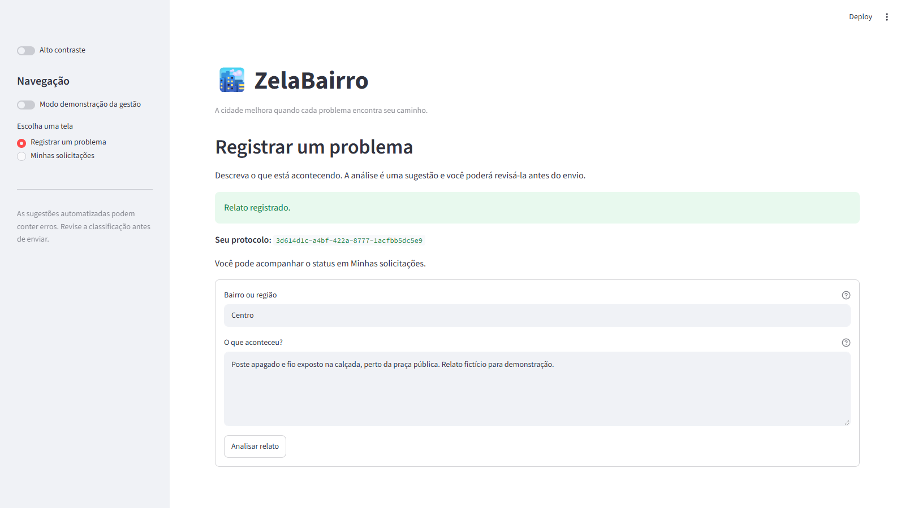
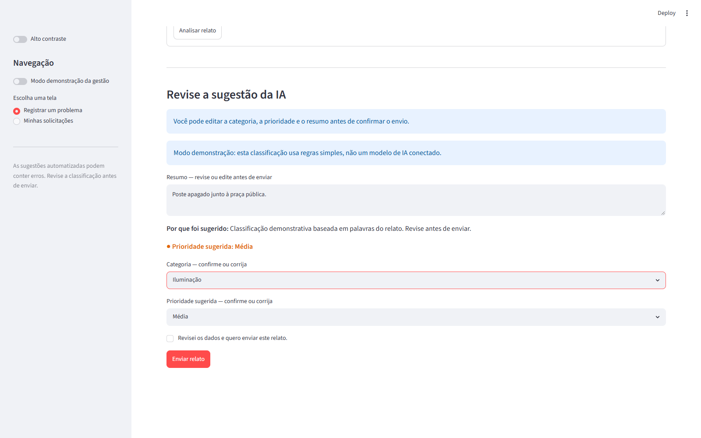
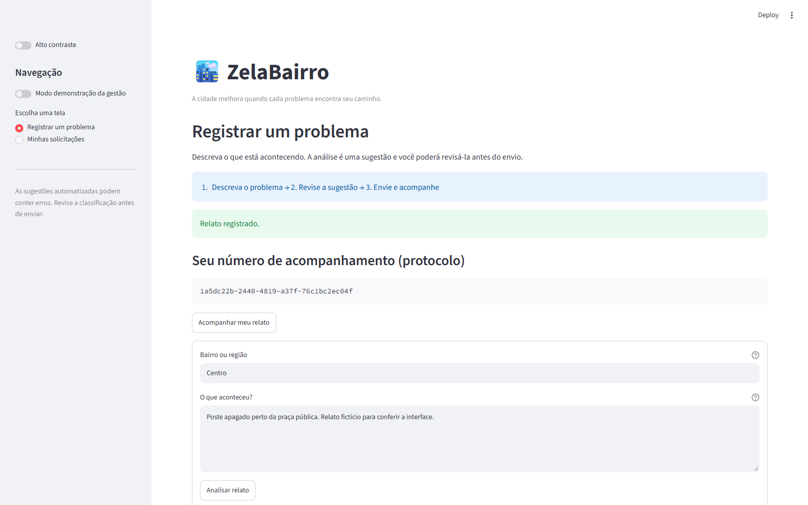
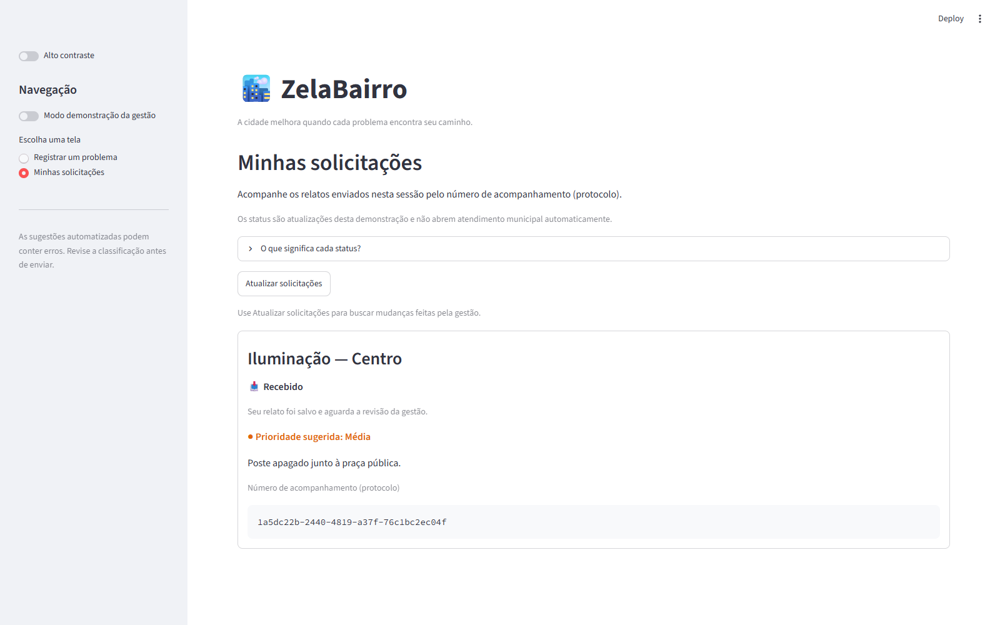
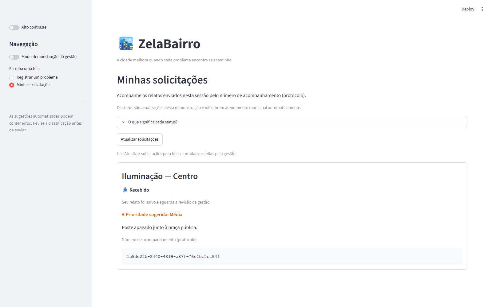

# Usabilidade — registros do grupo e ajustes

Registros recebidos em 13/11/2026. O grupo informou que os três testes ocorreram em sequência, antes das últimas correções, e esclareceu que P3 utilizou outra versão com edição de resumo. A data da sessão e os identificadores das versões testadas não foram informados. Os participantes são apresentados como P1, P2 e P3; nomes e idades foram omitidos da documentação pública.

As observações abaixo foram fornecidas pelo grupo. As capturas e os testes automatizados desta pasta são uma verificação técnica posterior, com dados fictícios, e não registros das sessões dos participantes.

## P1

**Perfil:** estudante universitária, familiarizada com aplicativos e plataformas digitais.

**Tarefas relatadas:** iniciou um relato de iluminação, informou bairro e descrição, revisou as sugestões da IA, confirmou o envio, recebeu protocolo e consultou o acompanhamento.

**Dificuldade:** dúvida sobre a possibilidade de alterar as sugestões antes de enviar.

**Comentário registrado:**

> Achei a plataforma bem fácil de usar. Gostei da ideia da IA organizar as informações, mas acho que poderia ficar mais claro que podemos alterar as sugestões antes de enviar.

## P2

**Perfil:** trabalha em período integral e usa aplicativos para comunicação e atividades cotidianas; familiaridade intermediária com tecnologia.

**Tarefas relatadas:** iniciou um relato sobre pavimentação, informou bairro e descrição, revisou a sugestão, confirmou o envio e recebeu protocolo. Tentou localizar a área de acompanhamento e relatou dificuldade nesse ponto; não foi registrada conclusão independente dessa tarefa.

**Dificuldade:** encontrar o acompanhamento e compreender alguns termos da interface.

**Comentário registrado:**

> A proposta é interessante e acho que seria útil para o bairro. Só senti falta de uma indicação mais clara de onde acompanhar o problema depois que ele é enviado.

## P3

**Perfil:** profissional administrativa, utiliza serviços digitais frequentemente e valoriza interfaces objetivas e organizadas.

**Tarefas relatadas:** iniciou um relato de calçada, informou bairro e descrição, analisou as sugestões, editou o resumo na outra versão informada pelo grupo, confirmou o envio, recebeu protocolo e consultou o status.

**Esclarecimento sobre a versão:** o grupo confirmou que P3 utilizou outra versão do ZelaBairro que permitia editar o resumo. Essa versão não foi fornecida nem identificada por commit; a tarefa é registrada conforme o relato do grupo. O ZIP original analisado tinha resumo somente para leitura, e a edição foi implementada nesta revisão da base entregue.

**Dificuldade:** compreender as etapas do processo e o significado dos status.

**Comentário registrado:**

> Gostei bastante da proposta. Acho importante que o cidadão consiga entender o que acontece depois do envio. Uma indicação das etapas ajudaria a deixar tudo mais claro.

## Ajustes implementados em 13/11/2026

| Feedback | Antes na base entregue | Ajuste implementado | Verificação técnica |
|---|---|---|---|
| P1: edição pouco clara | Categoria e prioridade editáveis; resumo somente para leitura. | Aviso explícito sobre os três campos e editor de resumo, com validação de 5 a 300 caracteres. | Resumo alterado foi enviado e preservado no histórico; valores vazios/curtos foram bloqueados. |
| P2: protocolo pouco destacado | Número em texto junto à mensagem de sucesso. | Título explicativo e bloco com o número de acompanhamento, disponível para copiar. | Protocolo visível na confirmação e no cartão do histórico. |
| P2: acompanhamento difícil de localizar | Acesso pela navegação lateral. | Botão “Acompanhar meu relato” após o envio, ligado à tela de solicitações. | Botão abriu o histórico do cidadão com o relato recém-enviado. |
| P3: etapas pouco claras | Orientação inicial sem sequência explícita. | Indicação “Descreva → Revise → Envie e acompanhe”. | Sequência exibida na tela de registro. |
| P3: significado dos status | Status com texto e ícone, sem explicação. | Descrição do status atual e seção “O que significa cada status?”. | Explicação e lista de status verificadas na interface. |

Arquivos alterados: `frontend/features/novo_relato.py`, `frontend/features/minhas_solicitacoes.py`, `frontend/ui/components.py`, `frontend/state/session.py` e `frontend/app.py`.

## Comparação visual

As imagens usam relatos fictícios e não identificam participantes. A imagem anterior foi preservada de uma demonstração da versão antiga. As imagens posteriores foram produzidas na conferência local com regras demonstrativas, sem chamada ao LLM.

**Antes — confirmação e protocolo:**

**Depois — revisão com resumo editável:**

**Depois — protocolo e acesso ao acompanhamento:**

**Depois — acompanhamento e significado do status:**

## Resultado e limites

Os 42 testes automatizados passaram, incluindo edição/persistência do resumo, bloqueio de resumo inválido e navegação a partir do protocolo. A conferência no navegador confirmou o fluxo com dados fictícios. O [relatório de testes](testes.xml) registra a execução técnica.

O aprendizado foi tornar explícitas ações que estavam disponíveis ou implícitas: o cidadão pode revisar a sugestão, precisa reconhecer seu número de acompanhamento e deve compreender o status sem conhecer o funcionamento interno da POC.

Melhor compreensão e maior facilidade de uso são resultados esperados. Não foi informado reteste com os participantes após os ajustes; não há medida comparativa de tempo, sucesso ou satisfação. A gravação técnica de 13/11/2026 incorporou estas evidências e os ajustes e está [publicada no YouTube como não listada](https://youtu.be/17K65Aqt3Qs). A origem de 12/11 permanece preservada no projeto local de montagem.
